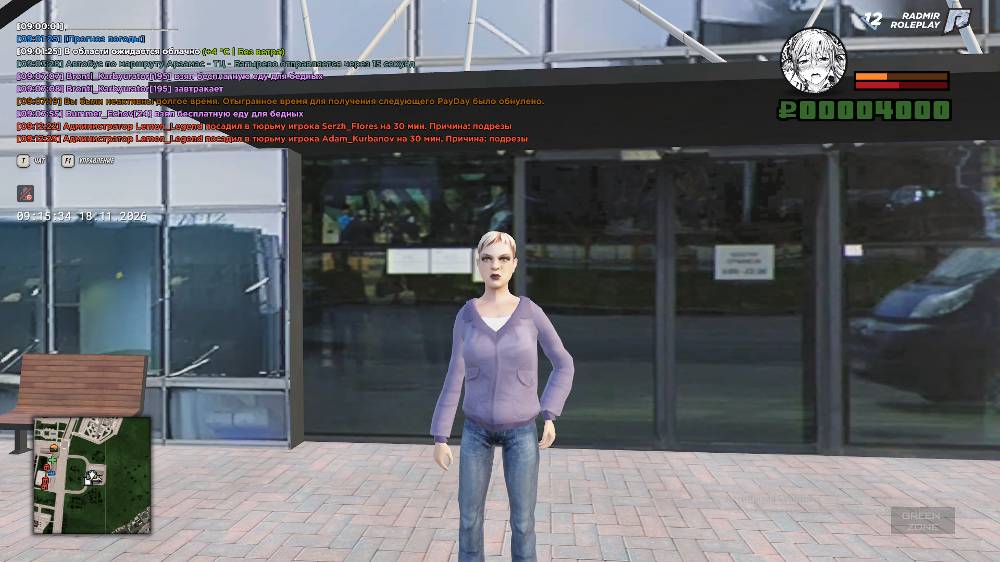
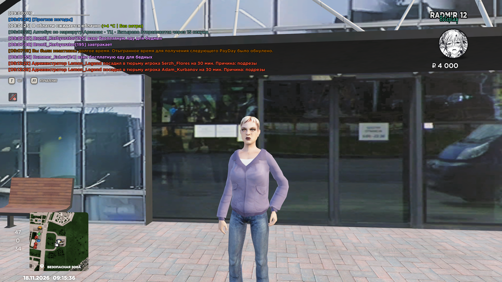

# Hassle Studio

Смена HUD в Hassle Online: выбираешь готовый шаблон, подгоняешь чат и часы, двигаешь элементы мышкой. Если не хватает картинки или хочется свою — её можно заменить через меню. Внутри 40 вариантов шаблонов. Конструктора HUD с нуля здесь нет.

Проект написан на Rust и собирается в **x64 DLL для Windows**. Название репозитория `radmir-loader-images` осталось, но загрузчик рассчитан на `HassleOnline-Win64-Shipping.exe`. Для старого RADMIR x86 / D3D9 эта версия не подходит. Надписи RADMIR на некоторых шаблонах — часть их оформления, а не признак поддержки другого клиента.

## Как выглядит в игре

**OLD style · Maximum.** Шкалы и деньги справа сверху, квадратный радар слева снизу; отдельно включены часы с датой.



**Purple Spring GTA · Maximum.** Другое расположение радара, показателей и времени. Здесь хорошо видно ограничение сборки: часть графики отсутствует, поэтому рядом с радаром остаются числа без оригинальных значков.



Это реальные кадры из Hassle Online с применёнными JS/CSS этих шаблонов через Gameface inspector, не макеты. На них показан HUD без окна настроек. Полного комплекта оригинальных изображений нет, поэтому обещать точное совпадение всех шаблонов с их оригиналами нельзя.

## Что скачать

Готовая сборка — в [Releases](https://github.com/pnwjdw/radmir-loader-images/releases/latest). Нужен архив `HassleStudio-x64.zip`, а не автоматически созданный GitHub архив `Source code`.

Распакуй его в отдельную папку, куда разрешена запись. Рядом должны лежать:

```text
HassleStudio/
  HassleStudio.dll
  HassleStudioLauncher.exe
```

Папку `assets` для запуска копировать не нужно: шаблоны, имеющиеся картинки и шрифты уже встроены в DLL. `init.ini` появится рядом с DLL после сохранения настроек.

### Что нужно для работы

- Windows x64 и запущенный Hassle Online x64.
- Доступный **Gameface inspector в процессе игры**. Через него модуль меняет игровой интерфейс. Сам он отладчик не включает и защиту клиента не обходит.
- Одинаковый уровень прав у игры и загрузчика. Если игра запущена от администратора, загрузчику тоже понадобятся эти права.

В проверенном клиенте inspector был доступен по адресу `http://127.0.0.1:9444/json/list`. Это адрес для проверки, не страница настроек мода. Загрузчик не требует вручную прописывать порт: модуль ищет inspector среди портов процесса игры. Если в твоей версии клиента отладчик отключён, одного инжекта недостаточно. Универсального переключателя для всех версий клиента здесь нет.

## Запуск и инжект

1. Запусти игру и дождись загрузки игрового интерфейса.
2. Запусти `HassleStudioLauncher.exe` из папки рядом с DLL.
3. Вернись в игру. После запуска должно появиться меню **HASSLE STUDIO**. Клавиша **Insert** открывает и скрывает его.
4. На вкладке **«Шаблон»** выбери оформление. Изменения применяются без перезапуска игры.
5. Настрой остальные вкладки и закрой меню через Insert, когда закончишь.

Launcher сам находит процесс игры, загружает `HassleStudio.dll` и вызывает её запуск. Сторонний инжектор не нужен. Просто загрузить DLL через `LoadLibrary` сторонним инструментом недостаточно: инициализация запускается отдельным экспортом `HassleStudioStart`, а не из `DllMain`.

Если открыто несколько копий игры, выбери PID в диспетчере задач на вкладке «Подробности» и укажи его явно:

```bat
HassleStudioLauncher.exe --pid 12345
```

`12345` здесь пример — подставь PID своей игры. Не нужно выбирать процесс обычного лаунчера Hassle: нужен именно `HassleOnline-Win64-Shipping.exe`.

## Что есть в меню

### Шаблон

Верхний список выбирает HUD и его редакцию: Basic, Maximum, Free и другие. Это названия вариантов из каталога, не переключатель оплаты в программе.

Ниже появляются собственные параметры выбранного шаблона: галочки, ползунки и списки. Их набор зависит от оформления. Если у одного HUD есть переключатель, это не значит, что он будет у остальных. Меню показывает параметры, которые предусмотрены самим шаблоном; отдельного редактора логотипов, диалогов или спидометра нет.

- **«Сбросить настройки этого шаблона»** возвращает текущий вариант к его исходным настройкам. Это полный сброс для выбранного шаблона: его параметры, оформление чата и часов, расположение и подмены картинок. Остальные шаблоны не затрагиваются.
- **«Перечитать init.ini»** заново загружает сохранённые настройки с диска. Пригодится, если заменил конфиг своей резервной копией. Это не пересборка и не обновление DLL.

У каждого шаблона свои настройки. Можно передвинуть радар в OLD style, перейти на Purple Spring и настроить его иначе — при возвращении сохранённое положение восстановится.

### Чат

Эта вкладка меняет внешний вид существующего игрового чата, а не создаёт второй чат.

| Пункт | Что делает |
| --- | --- |
| Изменять оформление чата | Включает применение настроек этой вкладки. Без галочки они не используются. |
| Жирный шрифт | Делает текст жирным. |
| Список шрифтов | Выбирает шрифт чата из доступных в сборке. |
| Размер шрифта | Размер текста: от 8 до 48. |
| Высота строки | Расстояние между строками. Если текст слипается, увеличь его. |
| Строк | Сколько строк показывать: от 1 до 50. |
| Ширина | Ширина области чата. |
| X / Y | Положение по горизонтали и вертикали. |
| Обводка | Толщина обводки текста, чтобы он читался на светлом фоне. |
| Непрозрачность | Видимость чата: 1 — непрозрачный, 0 — невидимый. |

### Время

Часы используют местное время компьютера. Это не отдельный источник серверного времени.

| Пункт | Что делает |
| --- | --- |
| Показывать время | Включает часы. |
| Жирный шрифт | Жирное начертание для отдельных часов. |
| Секунды | Добавляет секунды. |
| Миллисекунды | Добавляет доли секунды. |
| 24-часовой формат | `21:05` вместо `9:05 PM`. |
| Показывать дату | Добавляет дату. |
| Отдельные часы вместо часов шаблона | Выводит собственные часы вместо встроенных в оформление. |
| Список шрифтов | Выбирает шрифт отдельных часов. |
| Размер отдельных часов | Размер текста отдельных часов. |
| X / Y отдельных часов | Положение отдельных часов. |

По умолчанию модуль старается использовать часы самого шаблона, сохраняя его оформление. Если их нет, выводятся отдельные. Поэтому размер, шрифт и координаты отдельных часов не обязаны менять встроенные часы HUD. Чтобы управлять именно этими параметрами, включи **«Отдельные часы вместо часов шаблона»**. Положение встроенного блока можно менять через «Расположение».

### Изображения

**Части оригинальных картинок в проекте нет.** Пустая иконка или отсутствующий фон не обязательно означают, что не сработал инжект. У шаблона может просто не быть нужного ресурса.

Можно нарисовать свою картинку, экспортировать её в PNG или GIF и подставить вместо отсутствующей. Для PNG удобно оставить прозрачный фон. Анимированный GIF тоже поддерживается — анимация сохраняется.

На вкладке есть:

- **Поиск пути ресурса** — фильтр списка по части имени, например `health` или `weapon`.
- **Список ресурсов** — пути, используемые выбранным шаблоном. Метка **`[нет]`** означает, что встроенного файла нет; **`[замена]`** — что для него уже сохранена своя картинка.
- **Поле пути** — точный путь заменяемого ресурса. Его можно выбрать из списка или вписать вручную.
- **Большое текстовое поле** — сюда вставляется содержимое картинки в Base64, а не путь к файлу на компьютере и не ссылка на сайт.
- **«Применить»** — проверяет картинку и сохраняет подмену для текущего шаблона.
- **«Убрать замену»** — удаляет подмену выбранного пути. Если исходная картинка была, вернётся она; если её не было, ресурс снова будет отсутствовать.

#### Как добавить свою PNG или GIF

1. Сделай картинку подходящего размера. Начни с небольшой — огромная текстура для маленькой иконки не нужна.
2. Переведи файл в Base64. Например, открой **PowerShell** и выполни, указав свой путь:

   ```powershell
   $file = 'C:\Pictures\my-health.png'
   $base64 = [Convert]::ToBase64String([IO.File]::ReadAllBytes($file))
   Set-Clipboard -Value ('data:image/png;base64,' + $base64)
   ```

   Для GIF укажи файл `.gif` и замени префикс на `data:image/gif;base64,`. Это обычные команды PowerShell, отдельный скрипт устанавливать не надо. Изображение никуда не загружается: результат попадает в буфер обмена.

3. В игре открой **«Изображения»**, выбери нужный ресурс.
4. Нажми на большое поле и вставь текст через **Ctrl+V**.
5. Нажми **«Применить»** и дождись окончания проверки. На время обработки кнопка недоступна.

Подходит и чистый Base64 без префикса. Имя ресурса менять под формат картинки не нужно: даже если исходный путь заканчивается на `.svg`, подмена может быть PNG или GIF. Выбирай именно путь из шаблона, а не `C:\Pictures\...`.

Ручные пути разрешены только внутри `oneas-img/` и `images/`, без `..`, пробелов и адресов сайтов. Подмена меняет уже используемый ресурс; она не добавляет новый элемент HUD сама по себе.

Ограничения:

- PNG и GIF; JPEG, WebP и SVG в качестве загружаемой подмены не принимаются.
- Размер от 1×1 до 2048×2048.
- До 8 МиБ Base64 на картинку — это размер закодированного текста, а не исходного файла.
- GIF: до 240 кадров и 96 МиБ суммарно после распаковки кадров.
- Суммарно до 32 МиБ строк с картинками на один шаблон; весь `init.ini` — до 64 МиБ.

Подмены хранятся внутри `init.ini` отдельно для каждого шаблона. Исходный PNG после применения не нужен для запуска, но его лучше сохранить для дальнейшего редактирования. Не пересылай конфиг, если не хочешь делиться добавленными картинками.

### Расположение

При **открытом меню** наведи мышь на элемент HUD **вне окна настроек**:

- **ЛКМ + движение мыши** — перетащить элемент.
- **Колесо** — увеличить или уменьшить его.
- **Alt не нужен.**

Под курсором появляется рамка выбранного элемента. Если окно меню закрывает нужную часть HUD, сначала отодвинь само окно.

Для точной настройки выбери элемент в списке вкладки:

| Пункт | Что делает |
| --- | --- |
| Смещение X | Сдвигает относительно исходного положения по горизонтали. |
| Смещение Y | Сдвигает относительно исходного положения по вертикали. |
| Масштаб | Меняет размер от 0,25 до 4; 1 — исходный размер. |
| Сбросить элемент | Возвращает выбранному элементу смещение 0 / 0 и масштаб 1. |
| Сбросить все положения | Сбрасывает расположение элементов текущего шаблона, не удаляя его остальные настройки. |

Здесь перемещаются найденные элементы интерфейса. Список зависит от выбранного шаблона и того, что сейчас есть на экране. Это не редактор произвольных окон игры.

## Сохранение настроек

Отдельной кнопки «Сохранить» нет: изменения сохраняются автоматически в `init.ini` рядом с DLL. Дай модулю закончить сохранение перед копированием файла. Если папка защищена от записи, перенеси сборку в обычную пользовательскую папку.

Для резервной копии достаточно скопировать `init.ini`. Чтобы вернуть её, лучше сначала штатно остановить модуль, заменить файл, затем запустить снова. Для чтения файла без остановки есть кнопка **«Перечитать init.ini»** и команда `--reload`.

Старое состояние `custom` не загружает удалённый собственный HUD: при чтении оно пропускается, а вместо активного `custom` выбирается стандартный шаблон. Личный конфиг в репозиторий и готовый архив не включён.

## Скрыть меню, остановить или выгрузить DLL

Это разные действия. Insert только убирает окно настроек; выбранный HUD продолжает работать.

Команды выполняются из папки сборки. В PowerShell используй относительный путь к EXE, например: `.\HassleStudioLauncher.exe --status`.

```bat
HassleStudioLauncher.exe --hide
HassleStudioLauncher.exe --show
HassleStudioLauncher.exe --status
HassleStudioLauncher.exe --reload
HassleStudioLauncher.exe --stop
HassleStudioLauncher.exe --unload
```

| Команда | Действие |
| --- | --- |
| Без аргументов | Загружает и запускает модуль. Если он уже работает, показывает меню. |
| `--hide` | Скрывает только меню. |
| `--show` | Показывает меню. |
| `--status` | Запрашивает числовое состояние модуля. Не запускает его. |
| `--reload` | Просит работающий модуль перечитать `init.ini`. |
| `--stop` | Останавливает работу и восстанавливает интерфейс, но оставляет DLL загруженной. После успешной остановки её можно снова запустить обычной командой. |
| `--unload` | Сначала выполняет штатную остановку, затем освобождает DLL. Это команда для полного отключения перед заменой сборки. |
| `--pid PID` | Указывает конкретный процесс игры; можно добавить к любой операции. |
| `--quiet` | Не показывает окно с ошибкой, оставляет сообщение в консоли. |
| `--help` | Показывает список аргументов. |

Выбирай **одну операцию за запуск**. Например, для полного отключения конкретной копии игры:

```bat
HassleStudioLauncher.exe --pid 12345 --unload
```

Закрытие консольного окна загрузчика само по себе не выгружает DLL. Для обновления сначала выполни `--unload`, затем замени файлы и запусти загрузчик снова.

Если штатная остановка вернула ошибку, выгрузка блокируется. Не пытайся принудительно освобождать DLL сторонним инжектором — перезапусти игру. После ошибки рабочего потока повторный запуск этой же загруженной DLL также блокируется до перезапуска игры.

## Если что-то не работает

| Что произошло | Что проверить |
| --- | --- |
| «Запустите Hassle Online x64» | Игра уже должна быть запущена. Нужен процесс `HassleOnline-Win64-Shipping.exe`; при нескольких копиях укажи `--pid`. |
| «Требуется DLL x64» | Не смешивай файлы разных сборок. DLL должна быть 64-битной. |
| Ошибка открытия процесса | Проверь права загрузчика и игры. Не отключай защиту системы ради запуска. |
| «Другая копия HassleStudio уже загружена» | Используй загрузчик из папки той DLL, которая уже находится в игре, и штатно выгрузи её. Либо перезапусти игру. |
| Меню не видно | Верни фокус игре, нажми Insert или выполни `--show`. |
| Меню есть, а HUD не меняется | Посмотри строку состояния внизу меню. Если не найден Gameface inspector, модуль не может управлять интерфейсом. |
| Не хватает фона или значков | Найди ресурс с меткой `[нет]` во вкладке «Изображения». Оригинальные картинки не все сохранились; можно добавить свои. |
| Часы не двигаются ползунками X / Y | Эти координаты относятся к отдельным часам. Включи соответствующую галочку либо двигай встроенный блок через «Расположение». |
| Картинка не принимается | Проверь формат, размеры, лимит кадров GIF и то, что скопирован Base64 файла, а не его имя или URL. |
| Настройки пропадают | Проверь возможность записи в папку DLL. Разные шаблоны имеют отдельные настройки — это нормально. |
| `HassleStudioStop: 31` или ошибка остановки | Не форсируй выгрузку. Перезапусти игру; проверь конфиг перед следующим запуском. Число 31 само по себе не объясняет первопричину. |
| `HassleStudioStart: 0`, но результата нет | Это подтверждение запуска рабочего потока, а не проверка готовности HUD. Ошибка может произойти позднее. |

## Сборка из исходников

Нужны **Rust 1.88+**, **Visual Studio C++ Build Tools** с компонентами для x64 и **Windows SDK**. Открой **x64 Native Tools Command Prompt** и выполни в папке проекта:

```bat
cargo build --release --locked
```

Цель `x86_64-pc-windows-msvc` уже задана в `.cargo/config.toml`. Готовые файлы:

```text
target\x86_64-pc-windows-msvc\release\HassleStudio.dll
target\x86_64-pc-windows-msvc\release\HassleStudioLauncher.exe
```

Скопируй оба в одну папку. Для проверки форматирования и предупреждений:

```bat
cargo fmt --check
cargo clippy --locked --all-targets -- -D warnings
```

### Где что лежит

- `src/launcher/` — поиск игры, инжект и команды загрузчика.
- `src/ui.rs` — окно настроек и управление расположением.
- `src/bridge.rs` — соединение с Gameface inspector.
- `src/settings.rs` — чтение и сохранение настроек.
- `src/images.rs` — проверка PNG/GIF и допустимых путей.
- `assets/templates/catalog.json` — полный список 40 вариантов.
- `assets/templates/` — скрипты, стили и сохранившиеся ресурсы шаблонов.
- Остальные скрипты в `assets/` — применение шаблонов, чат, часы, расположение и вывод меню.

Ресурсы встраиваются во время сборки. Если изменил файлы в `assets`, пересобери DLL: редактирование этой папки рядом с готовой сборкой ничего не изменит. Для пользовательских картинок без пересборки есть вкладка «Изображения».

## Ограничения и чужие ресурсы

Это не официальный инструмент Hassle Online или RADMIR. После обновления клиента структура интерфейса может измениться, и совместимость не гарантируется. Перед использованием проверь правила своего сервера: техническая возможность загрузить модуль не означает, что администрация разрешает такие изменения. Гарантий отсутствия блокировок нет.

Полный набор оригинальных изображений отсутствует. Подмены помогают заполнить пробелы, но не восстанавливают оригиналы автоматически.

В проекте есть сторонние шаблоны, изображения и шрифты. Права на их публичное распространение не подтверждены; наличие файлов в этом репозитории не означает разрешения использовать их в своих публикациях или коммерческих работах. Авторство сторонних ресурсов не присваивается. Перед дальнейшим распространением нужно разобраться с разрешениями правообладателей.

В Git лежат исходники и встроенные ресурсы; готовые DLL/EXE распространяются отдельно через Releases. Кэш сборки, временные проверки и личный `init.ini` сюда не входят.
